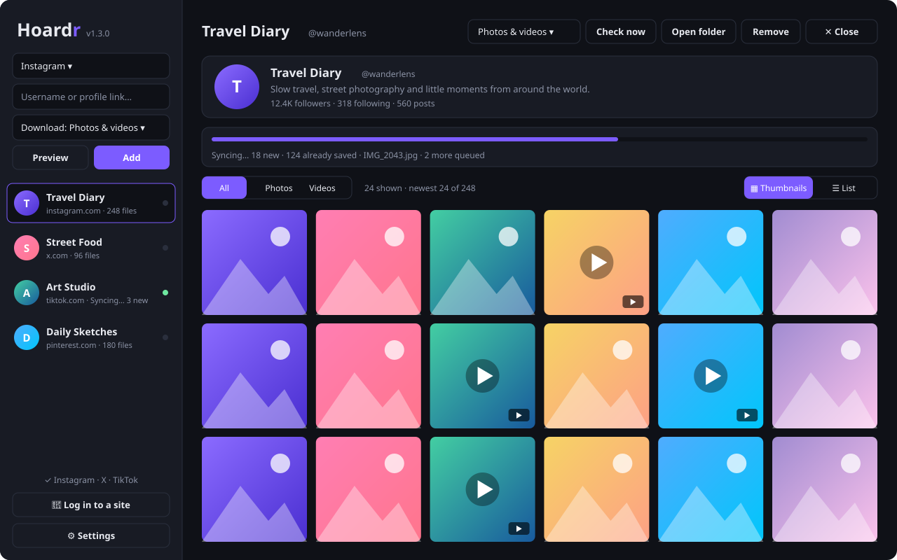
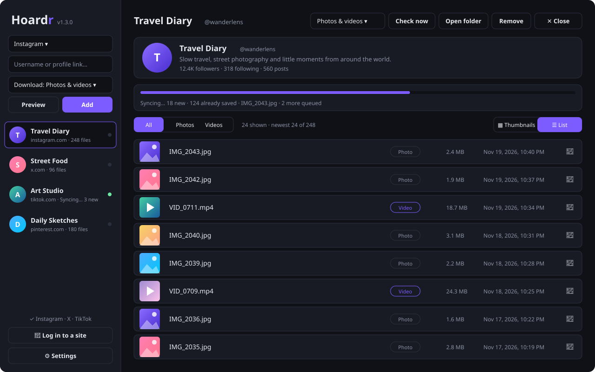

<div align="center">


# Hoardr

**A clean, cross-platform desktop app for saving public media from social profiles.**
Powered by [gallery-dl](https://github.com/mikf/gallery-dl) and [yt-dlp](https://github.com/yt-dlp/yt-dlp).

[](../../releases)
[](../../actions)
[](LICENSE)

[**Download**](../../releases/latest) · [**Website**](https://fsocietyshinjuu.github.io/Hoardr) · [Changelog](CHANGELOG.md)

</div>

## 🖼️ App preview

| Thumbnails | List |
|---|---|
|  |  |

*Illustrations of the interface. Replace them with real screenshots (`docs/preview.png`) whenever you like.*

## ✨ Features
- 🔑 **In-app login**: sign in to Instagram, X, Facebook, Threads, TikTok and more inside Hoardr
- 🎛️ **Photos, videos or both**: choose per profile, change any time
- 🗂️ **Thumbnails or list** gallery with All / Photos / Videos filter and a Close button
- ⚡ **Auto-start**: a new profile downloads immediately; several profiles sync in parallel
- ⌨️ **Add by username**: pick the site, type a username or paste a link
- 👤 **Profile cards** with picture, name and bio
- 🔔 **Tray mode**: closing the window keeps syncing in the background
- 📚 **Subscriptions**: add profiles once; only new posts are downloaded on each check
- ⏱️ **Auto-check** on a schedule (30 min to daily)
- 🖼️ **Built-in gallery** for every profile
- 👀 **Preview** a profile before subscribing
- 📦 Engines bundled, no extra setup
- 🖥️ Windows · macOS · Linux

## 🔄 Updates
The installed app updates itself: it checks GitHub Releases on launch, downloads quietly, then offers **Restart & update**. macOS (unsigned), the Windows portable build and the Linux `.deb` show a **Download** notice instead.

## 🌐 Supported sites
Anything gallery-dl or yt-dlp supports, including Instagram, X/Twitter, Facebook, Threads, Reddit, Pinterest, TikTok, YouTube, Vimeo and many more. Coverage changes as sites change.

> 🚫 **Not supported:** OnlyFans, Fantia and similar paid, subscriber-only services. They are blocked in the app.

## 🚀 Quick start
1. Grab the installer from [Releases](../../releases/latest).
2. Click **🔑 Log in to a site**, sign in, and close the login window.
3. Paste a profile link, press **Preview**, then **Add**. Hoardr downloads it and keeps it synced.

<details><summary><b>🍪 Using cookies</b></summary>

Export cookies from a browser you are logged into using a "cookies.txt" extension (Netscape format), then select the file under **Advanced**. Treat the file like a password and never share it.
</details>

<details><summary><b>🛠️ Build from source</b></summary>

```bash
git clone https://github.com/fsocietyshinjuu/Hoardr && cd Hoardr
mkdir bin   # place yt-dlp and gallery-dl binaries here (or have them on PATH)
npm install
npm start          # run
npm run dist       # package
```
</details>

<details><summary><b>📦 Publishing a release</b></summary>

```bash
git tag v1.0.0 && git push origin v1.0.0
```
The **Release** workflow builds all three platforms and attaches installers to a GitHub Release using `RELEASE_NOTES.md`.
</details>

<details><summary><b>🌍 Landing page</b></summary>

Repo **Settings → Pages → Source: GitHub Actions**. The **Pages** workflow deploys `/docs`.
</details>

## ⚖️ Responsible use
Only download content you own or have permission to save. Respect creators, site terms and your local laws. The authors are not responsible for misuse.

## 📄 License
MIT © fsocietyshinjuu
